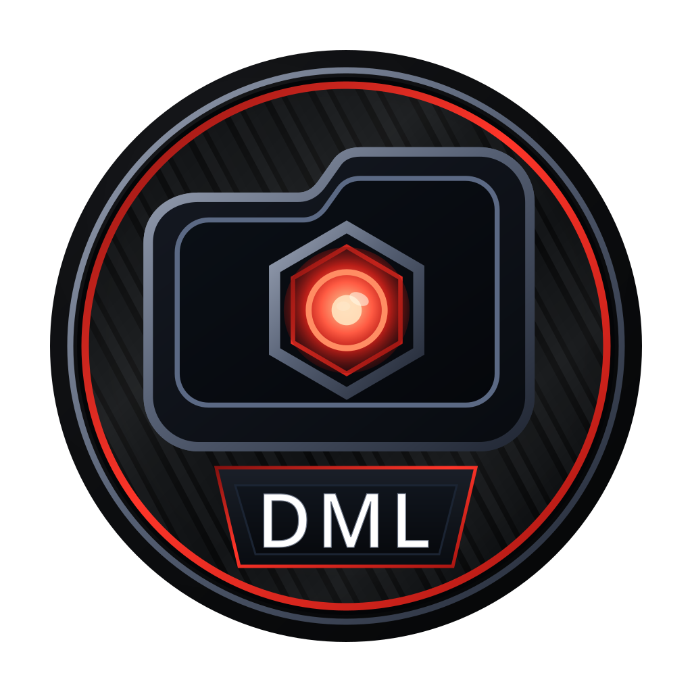

  

<h1 align="center">Droid Mod Loader</h1>

<strong>Bethesda mod management with profiles for Android.</strong>

Droid Mod Loader, or DML, manages Bethesda game mods for Windows compatibility
environments hosted on Android. It keeps installed mods separate, tracks profiles
and plugin state, and deploys a resolved mod setup to selected game folders.

> [!WARNING]
> DML is beta software that can write to game folders. Back up important game
> files before testing a new build or deployment setup.

## Current support

The current public release is `v0.7.0-beta`.

DML currently supports early workflows for:

- Skyrim Legendary Edition;
- Fallout: New Vegas;
- Fallout 3;
- Oblivion; and
- Tale of Two Wastelands through a Fallout: New Vegas target.

Current capabilities include profiles, direct Archive Library browsing, managed
mod installation, mod enable/disable and priority, Bethesda plugin discovery and
ordering, deployment planning, physical deployment, diagnostics that report the
selected target, and recovery foundations.

DML uses direct filesystem paths and Android all files access for shared storage
workflows. Android 11 or newer is required.

Archive support depends on the actual archive format and variant. Unsupported
archives are rejected rather than treated as installable because of their file
extension alone.

## Compatibility environments

DML is intended for Android Windows compatibility setups that expose usable game
folders through shared storage, including GameNative workflows. DML does
not modify or depend on another application's protected private storage.

Android may still block access to another application's protected `Android/data`
directory even when all files access is enabled.

## Get started

1. Download the latest APK from the [GitHub releases page](https://github.com/Shonkware/DroidModLoader/releases).
2. Back up the game folder you plan to test.
3. Read the [User Guide](docs/user-guide.md).
4. Use [Troubleshooting](docs/troubleshooting.md) if setup, import, plugin, or deployment behavior looks wrong.

## Project links

- [User Guide](docs/user-guide.md)
- [Troubleshooting](docs/troubleshooting.md)
- [Changelog](releases/changelog.md)
- [Contributing](CONTRIBUTING.md)
- [ARM64Nexus community](https://discord.gg/RvTWcEeJ7Z)

## Contributing

Bug reports, compatibility notes, documentation corrections, reproducible test
cases, and focused code changes are welcome. See [CONTRIBUTING.md](CONTRIBUTING.md).

## License

Droid Mod Loader is released under the [MIT License](LICENSE).

## Disclaimer

Droid Mod Loader is an independent project. Users remain responsible for the
licenses and permissions of games, mods, and external tools they use.
